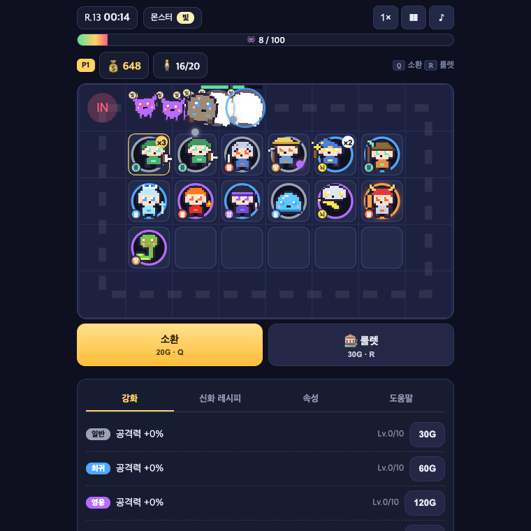

# 🎲 Lucky Merge Defense

모바일 랜덤 디펜스 **운빨존많겜(Lucky Defense)** 의 재미를 브라우저로 옮긴 **싱글플레이 웹 디펜스 게임**.
뽑기는 운, 배치는 실력. 루프를 도는 몬스터가 **100마리**를 넘기 전에 **40라운드(보스 4회)** 를 버티세요.

**▶ 바로 플레이: https://jwdev1995.github.io/lucky-merge-defense/**

<p align="center"></p>

## 특징
- **랜덤 소환** (20G) — 일반 68% · 희귀 24% · 영웅 7% · 전설 1%
- **같은 유닛 3개 → 합성** → 다음 등급의 랜덤 유닛. 한 칸에 최대 3개 스택(피해 ×스택)
- **신화 레시피 4종** — 재료 유닛 3종을 모아 조합 (불사조 · 혼돈의 군주 · 천사장 · 세계수)
- **유닛 22종** × 공격 타입 7종 (단일 / 광역 / 연쇄 / 관통 / 둔화 / 중독 / 화상 / 치명타)
- **40라운드**, 10·20·30·40 라운드 보스 — 20초 안에 못 잡으면 패배
- **행운의 룰렛** (30G), **등급별 강화**, 유닛 이동/교환/판매
- 1× / 2× / 3× 배속, 최고 기록 로컬 저장, PC/모바일 반응형(터치 1탭 조작)
- **픽셀 아트 스프라이트 30종**(유닛 22 + 몬스터 3 + 보스 4)을 문자열 그리드로 코드에서 생성 — 외부 라이브러리·에셋·빌드 도구 없음 (Vanilla JS + Canvas, 효과음은 WebAudio 합성)

## 조작
| 입력 | 동작 |
|---|---|
| 칸 탭/클릭 | 유닛 선택 → 정보 · 합성 · 판매 |
| 선택 후 다른 칸 탭 (또는 드래그) | 이동 / 교환 / 같은 유닛 겹치기 |
| `Q` / `R` | 소환 / 룰렛 |
| `E` / `S` | 선택 유닛 합성 / 판매 |
| `1` `2` `3` | 배속 |
| `P` / `ESC` | 일시정지 / 선택 해제 |
| `M` | 음소거 |

## 로컬 실행
ES Module을 사용하므로 정적 서버로 여세요.
```bash
python3 -m http.server 8090
# → http://localhost:8090
```

## 밸런스 시뮬레이터
단순 봇이 N판을 자동 플레이해 도달 라운드 분포를 출력합니다. 밸런스 수치는 모두 `js/config.js` 한 곳에서 관리합니다.
```bash
node tools/sim.mjs 40
```

## 구조
```
index.html        화면/HUD 마크업
css/style.css     디자인 토큰·레이아웃
js/config.js      밸런스 데이터 (유닛·몬스터·보스·확률·레시피·경제)
js/game.js        게임 로직 (DOM 비의존: 소환·합성·조합·라운드·전투)
js/sprites.js     픽셀 아트 스프라이트 정의 + 오프스크린 캐시
js/render.js      Canvas 렌더링 (보드·유닛·몬스터·투사체·이펙트)
js/ui.js          HUD·패널·카드·탭·토스트·결과 화면
js/input.js       포인터 입력 (탭/드래그)
js/audio.js       WebAudio 효과음
js/main.js        부트스트랩 + 게임 루프
tools/sim.mjs     헤드리스 밸런스 시뮬레이터
tools/sprites-sheet.html  스프라이트 시트 미리보기
docs/GDD.md       게임 기획서
docs/DESIGN.md    디자인 시스템
```

## 문서
- [게임 기획서 (GDD)](docs/GDD.md)
- [디자인 시스템](docs/DESIGN.md)

## 라이선스
MIT. 원작 운빨존많겜(111%)의 에셋·이름·수치는 사용하지 않은 팬 메이드 오마주입니다.
